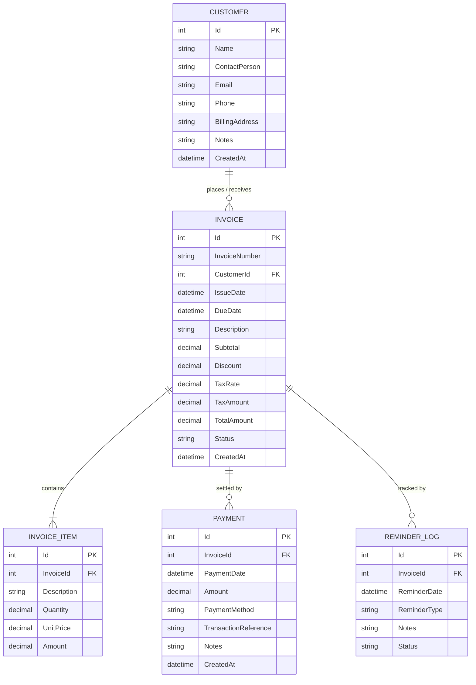

# PayPulse — Invoice & Payment Risk Tracker

[](https://dotnet.microsoft.com/)
[](https://docs.microsoft.com/en-us/dotnet/csharp/)
[](https://www.sqlite.org/)
[](https://docs.microsoft.com/en-us/ef/core/)
[](https://learn.microsoft.com/en-us/dotnet/architecture/maui/mvvm)
[](LICENSE)

A modern, high-performance Windows desktop application built with **WPF, C#, .NET 10, Entity Framework Core, and SQLite**. Designed for freelancers, agencies, and small businesses to manage invoicing, track payments, detect overdue bills, and assess customer payment risk using deterministic business rules.

---

## 📌 Problem Statement & Solution

Freelancers and small businesses often struggle with late-paying clients, scattered spreadsheets, and missed follow-ups:
- **Revenue Leakage:** Forgetting to follow up on overdue milestones.
- **Unclear Cashflow:** Lack of real-time insights into total billed vs. actually collected funds.
- **Credit Risk Blindspots:** Inability to identify chronically delinquent clients before extending further credit.

**PayPulse** solves this with a centralized, offline-first desktop platform that calculates real-time financials, enforces double-entry payment balancing, scores client payment risk, and exports ledger data.

---

## ⚡ Key Features

### 1. 📊 Executive Financial Dashboard
- **Live KPI Metrics:** Real-time calculation of Total Invoiced, Total Collected, Outstanding Receivables, Overdue Invoices Count, Active Clients, and Collection Rate percentage.
- **Overdue Invoices Warning:** Instant notification table highlighting high-priority overdue accounts.
- **Recent Invoices Ledger:** Color-coded status badges (`Paid`, `Unpaid`, `PartiallyPaid`, `Overdue`, `Draft`).

### 2. 👥 Customer Management (CRUD)
- Complete client directory with business name, primary contact, email, phone, billing address, and internal payment notes.
- Real-time search by company name, contact, or email.
- **Audit Protection:** Prevents accidental deletion of customers associated with active invoices.
- Dedicated client ledger history showing all past invoices and payment records.

### 3. 📄 Invoice & Line-Item Billing
- Dynamic multi-item invoice builder (Description, Quantity, Unit Price, Amount).
- **Automated Financial Math:** Exact decimal calculation for Subtotal, Discounts, and Indian GST (Tax Amount and Total Payable).
- Filters by status (`All`, `Unpaid`, `PartiallyPaid`, `Paid`, `Overdue`, `Draft`) and customer name.

### 4. 💳 Payment Management & Receipt Tracking
- Partial and full payment recording linked to specific invoices.
- **Overpayment Guard:** Enforces validation to prevent payment amounts exceeding remaining invoice balances.
- Supports Indian settlement standards: **UPI**, **Bank Transfer / NEFT**, **Cheque**, and **Cash**.
- Live balance breakdown (Total Billed, Amount Settled, Remaining Balance).

### 5. ⚠️ Deterministic Payment Risk Analysis
Rule-based scoring engine evaluating overdue aging, monetary exposure, and historical customer delinquency:
- **Risk Classification:** `Low Risk`, `Medium Risk`, and `High Risk` with dynamic color indicators.
- **Transparent Factors:** Explains *why* an invoice is flagged (e.g., *Overdue > 30 days*, *Exposure > ₹1,00,000*, *Client history delinquency ratio*).
- **📋 Copy Reminder Notice:** Generates a professional payment notice copied directly to your clipboard.
- **✓ Follow-up Logger:** Persists follow-up contact logs directly to the SQLite database.

### 6. 📈 Reports & CSV Spreadsheet Export
- **5 Built-in Financial Reports:**
  1. Invoices Summary Report
  2. Payment History Report
  3. Outstanding Balances Report
  4. Overdue Invoices Report
  5. Customer-wise Outstanding Ledger
- Date range filtering.
- **1-Click CSV Export:** Generates standard `.csv` spreadsheet files compatible with Excel and Google Sheets.

### 7. ⚙️ Settings & Live SQLite Database Explorer
- **Zero-Cloud Dependency:** Stored in a persistent local file (`%LOCALAPPDATA%\PayPulse\PayPulse.db`).
- **Live Database Table Explorer:** Built-in viewer allowing inspection of raw records and schema across `Customers`, `Invoices`, `InvoiceItems`, `Payments`, and `ReminderLogs`.
- **Demo Data Seeder:** 1-Click reset to realistic demonstration records for university viva and evaluations.

---

## 🏗️ Architecture & Technology Stack

```
PayPulse Solution Structure
│
├── PayPulse.sln
├── src/
│   └── PayPulse/
│       ├── PayPulse.csproj          (.NET 10 WPF Application)
│       ├── App.xaml / App.xaml.cs   (DI Bootstrapper & Unhandled Exception Shield)
│       ├── MainWindow.xaml / .cs    (Shell Host Window & Sidebar)
│       ├── Converters/              (Currency, Status badges, Risk brushes)
│       ├── Data/                    (EF Core DbContext, ModelBuilder, Seeder)
│       ├── Models/                  (Customer, Invoice, InvoiceItem, Payment, ReminderLog)
│       ├── Services/                (CalculationService, RiskAnalysisService, CsvExportService)
│       ├── ViewModels/              (MainViewModel, Dashboard, Customers, Invoices, etc.)
│       └── Views/                   (UserControls for each module)
└── tests/
    └── PayPulse.Tests/              (xUnit Test Suite covering business logic & math)
```

- **Frontend:** WPF (Windows Presentation Foundation) with XAML
- **Language:** C# 13 (.NET 10.0 Windows)
- **Architecture Pattern:** MVVM (Model-View-ViewModel) via `CommunityToolkit.Mvvm`
- **Dependency Injection:** `Microsoft.Extensions.DependencyInjection`
- **Database & ORM:** SQLite via Entity Framework Core (`Microsoft.EntityFrameworkCore.Sqlite`)
- **Unit Testing:** xUnit with EF Core In-Memory provider

---

## 🗄️ Database Entity Relationship (ER) Diagram



---

## 🚀 Getting Started

### Prerequisites
- Windows 10 / 11
- [.NET 10 SDK](https://dotnet.microsoft.com/download) (or .NET 8+)
- [Visual Studio 2022 / 2025](https://visualstudio.microsoft.com/) (with *.NET Desktop Development* workload) OR [Visual Studio Code](https://code.visualstudio.com/) (with *C# Dev Kit* extension)

### 1. Clone the Repository
```bash
git clone https://github.com/YOUR_USERNAME/PayPulse.git
cd PayPulse
```

### 2. Build the Solution
```powershell
dotnet build
```

### 3. Run the Application
```powershell
dotnet run --project src/PayPulse/PayPulse.csproj
```
*(Or press `F5` in Visual Studio / VS Code)*

### 4. Run Automated Unit Tests
```powershell
dotnet test
```

---

## 🧪 Unit Test Coverage

The test suite in `tests/PayPulse.Tests` verifies:
- Accurate GST tax and discount arithmetic.
- Full and partial settlement status transitions.
- Overdue invoice detection for past due dates.
- Boundary conditions (payments equal to invoice balance).
- Risk scoring thresholds and factor generation.
- Database seeder integrity.

---

## 📜 Academic Project Information
- **Project Title:** PayPulse — Invoice & Payment Risk Tracker
- **Domain:** Desktop Software Engineering / Financial Management Systems
- **Target Users:** Freelancers, Consultants, SMEs, Service Providers
- **Degree:** B.Tech Computer Engineering Major Project

---

## 📄 License
This project is licensed under the MIT License - see the [LICENSE](LICENSE) file for details.
